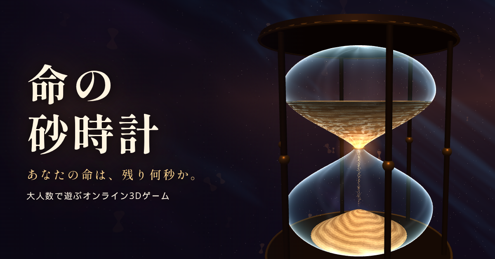

# 命の砂時計

巨大な砂時計の中で、命（残り秒数）を奪い、分け合う。大人数で遊ぶオンライン3Dゲーム。

**遊ぶ:** https://games.satoru.net/sunadokei/



## ルール

- 命は秒で減り、0秒で亡霊になる。金の粒を拾うと延びる。粒は下の球に多く降り、近くにあると足元の矢印が指す
- 砂時計は1巡に3回反転し、上下が入れ替わる。上の球は命の減りが半分だが、流砂で中心へ引き込まれる
- 突進で相手の命を砂にして散らせる。亡霊は合計10秒ぶんの粒か、分けてもらった命で蘇る（最後の刻は一度だけ）
- 結果発表では、人ごとに砂時計イイネを何回でも押せる

| 操作 | PC | スマホ |
| --- | --- | --- |
| 移動 | WASD | スティック |
| 視点 | マウス | 画面をドラッグ |
| 跳ぶ | Space | 跳ぶ |
| 突進 | Shift / 左クリック | 突進 |
| 命を分ける | E | 分ける |

## 動かし方

Node.js 22 で動作を確認しています。

```sh
npm install
npm run build
npm start        # http://127.0.0.1:3049/sunadokei/
```

| 環境変数 | 既定値 | 内容 |
| --- | --- | --- |
| `PORT` | `3049` | 待ち受けポート |
| `BASE_PATH` | `/sunadokei` | 配信パス |
| `MAX_CONN` | `600` | サーバー全体の接続上限 |
| `MAX_PER_IP` | `16` | 同じ接続元からの接続上限 |
| `DATA_DIR` | `./data` | イイネ累計の保存先 |
| `PUBLIC_DIR` | `./public` | 配信するファイルの場所 |
| `TIME_SCALE` | `1` | テスト用。結果発表までを早送りする倍率 |

## 構成

- `shared/world.js` 砂時計の形と砂、移動の計算（サーバーとクライアントで共用）
- `server/` 配信とWebSocket、ゲーム進行、砂人形（CPU）
- `client/` Three.js の描画、操作、HUD、OPムービー（`op.js`）
- `public/` 配信ファイル。`lyrics.html` は主題歌「イノチノスナドケイ」の歌詞ページ
- `tools/` 検算、ルールのテスト（`test_rules.mjs`）、負荷テスト、ブラウザでの動作確認、OGカード生成

## ライセンス

- **ソースコード:** [MIT](LICENSE)
- **主題歌「イノチノスナドケイ」（音源と歌詞）:** MIT の対象外です。音源はこのリポジトリに含まれないので、[歌詞ページ](https://games.satoru.net/sunadokei/lyrics.html)から入手し、`public/theme.mp3` に置くと曲が流れます。© 2026 satorunet, All rights reserved. 個人で聴くためのダウンロードは無料ですが、再配布、配信サービスへの登録、そのほかの利用には許可が必要です。
